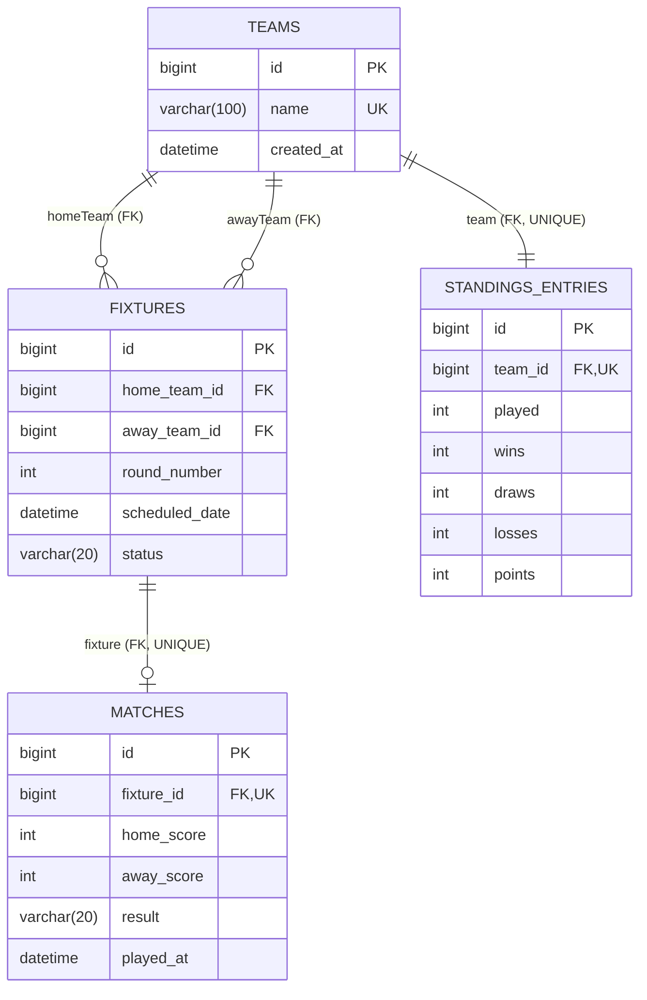

# LeagueTrack – Intramural Sports Tournament Fixture and Standings System

LeagueTrack is a dynamic full-stack web application built using **Java 21**, **Spring Boot 3.x**, **Spring Data JPA**, **Hibernate**, **MySQL**, **Thymeleaf**, and **Vanilla HTML5/CSS3/JavaScript**.

---

## 📁 Project Structure

```
leaguetrack/
│
├── pom.xml
├── README.md
│
├── src/
│   ├── main/
│   │   ├── java/
│   │   │   └── com/
│   │   │       └── leaguetrack/
│   │   │           ├── LeagueTrackApplication.java
│   │   │           │
│   │   │           ├── controller/
│   │   │           │   ├── TeamController.java
│   │   │           │   ├── FixtureController.java
│   │   │           │   ├── MatchController.java
│   │   │           │   ├── StandingsController.java
│   │   │           │   └── WebViewController.java
│   │   │           │
│   │   │           ├── service/
│   │   │           │   ├── TeamService.java
│   │   │           │   ├── FixtureService.java
│   │   │           │   ├── MatchService.java
│   │   │           │   └── StandingsService.java
│   │   │           │
│   │   │           ├── repository/
│   │   │           │   ├── TeamRepository.java
│   │   │           │   ├── FixtureRepository.java
│   │   │           │   ├── MatchRepository.java
│   │   │           │   └── StandingsEntryRepository.java
│   │   │           │
│   │   │           ├── model/
│   │   │           │   ├── Team.java
│   │   │           │   ├── Fixture.java
│   │   │           │   ├── Match.java
│   │   │           │   └── StandingsEntry.java
│   │   │           │
│   │   │           ├── dto/
│   │   │           │   ├── TeamRequest.java
│   │   │           │   ├── TeamResponse.java
│   │   │           │   ├── MatchResultRequest.java
│   │   │           │   ├── StandingsResponse.java
│   │   │           │   ├── FixtureResponse.java
│   │   │           │   └── DashboardStatsResponse.java
│   │   │           │
│   │   │           ├── enums/
│   │   │           │   ├── FixtureStatus.java
│   │   │           │   └── MatchResult.java
│   │   │           │
│   │   │           ├── config/
│   │   │           │   └── ScoringProperties.java
│   │   │           │
│   │   │           └── exception/
│   │   │               ├── ResourceNotFoundException.java
│   │   │               ├── BusinessRuleException.java
│   │   │               └── GlobalExceptionHandler.java
│   │   │
│   │   └── resources/
│   │       ├── application.properties
│   │       │
│   │       ├── templates/
│   │       │   ├── dashboard.html
│   │       │   ├── teams.html
│   │       │   ├── fixtures.html
│   │       │   └── standings.html
│   │       │
│   │       └── static/
│   │           ├── css/
│   │           │   └── style.css
│   │           │
│   │           └── js/
│   │               ├── dashboard.js
│   │               ├── teams.js
│   │               ├── fixtures.js
│   │               └── standings.js
│   │
│   └── test/
│       ├── java/
│       │   └── com/
│       │       └── leaguetrack/
│       │           ├── service/
│       │           │   ├── TeamServiceTest.java
│       │           │   ├── FixtureServiceTest.java
│       │           │   ├── MatchServiceTest.java
│       │           │   └── StandingsServiceTest.java
│       │           │
│       │           └── controller/
│       │               ├── TeamControllerTest.java
│       │               ├── FixtureControllerTest.java
│       │               ├── MatchControllerTest.java
│       │               └── StandingsControllerTest.java
│       │
│       └── resources/
│           └── application.properties
```

---

## 🛠️ Technology Stack

- **Language:** Java 21
- **Framework:** Spring Boot 3.4.3
- **Data & Persistence:** Spring Data JPA, Hibernate, MySQL Connector/J
- **Validation:** Jakarta Bean Validation (`@NotBlank`, `@NotNull`, `@PositiveOrZero`)
- **Frontend Template Engine:** Thymeleaf
- **Frontend Core:** HTML5, CSS3 (Modern Glassmorphism & Custom Properties), Vanilla JavaScript (ES6+ Fetch API)
- **Testing:** JUnit 5, Spring Boot Test, Spring MVC Test, H2 In-Memory DB (for unit test isolation)
- **Build Tool:** Apache Maven

---

## 🗄️ Database Schema & Entity Relationships



### Table Details:
1. **`teams`**:
   - `id` (PK, Auto-increment)
   - `name` (VARCHAR, Unique, Non-null)
   - `created_at` (DATETIME)
2. **`fixtures`**:
   - `id` (PK, Auto-increment)
   - `home_team_id` (FK -> `teams.id`)
   - `away_team_id` (FK -> `teams.id`)
   - `round_number` (INT)
   - `scheduled_date` (DATETIME)
   - `status` (`SCHEDULED`, `COMPLETED`)
3. **`matches`**:
   - `id` (PK, Auto-increment)
   - `fixture_id` (FK -> `fixtures.id`, UNIQUE)
   - `home_score` (INT >= 0)
   - `away_score` (INT >= 0)
   - `result` (`HOME_WIN`, `AWAY_WIN`, `DRAW`)
   - `played_at` (DATETIME)
4. **`standings_entries`**:
   - `id` (PK, Auto-increment)
   - `team_id` (FK -> `teams.id`, UNIQUE)
   - `played` (INT)
   - `wins` (INT)
   - `draws` (INT)
   - `losses` (INT)
   - `points` (INT)

---

## ⚙️ Configurable Scoring Rules

Configured dynamically in `application.properties`:
```properties
league.scoring.win=3
league.scoring.draw=1
league.scoring.loss=0
```
Scoring is managed via the `@ConfigurationProperties(prefix = "league.scoring")` class `ScoringProperties.java`.

---

## 🚀 Round-Robin Circle Scheduling Algorithm

- Calculates total fixtures: $N \times (N - 1) / 2$
- If $N$ is odd, a dummy `BYE` team is added to make the pool even ($N+1$), giving $N$ rounds with each team having one bye round.
- Uses the canonical **Circle Rotation Algorithm**:
  1. Fix team at index 0.
  2. Rotate teams in indices $1 \dots (M-1)$ clockwise on every round.
  3. Pair team $i$ with team $(M - 1 - i)$ for each match index.
  4. Alternate Home/Away designations between rounds to ensure balanced venues.

---

## 🔄 Match Result Editing & Standings Reversal

When a match score is modified via `PUT /api/matches/{fixtureId}/result`:
1. The previous match result (`HOME_WIN`, `AWAY_WIN`, or `DRAW`) is retrieved.
2. The exact previous points and win/draw/loss counts are subtracted from both participating teams' standings entries.
3. The new match result is determined based on the updated `homeScore` and `awayScore`.
4. The new points and records are added to the standings.
5. All updates are executed in a single atomic `@Transactional` boundary, preventing stale standings and double counting.

---

## 🛡️ Team Deletion & Standings Recalculation

When a team is deleted via `DELETE /api/teams/{id}`:
1. All fixtures involving the team (as either `homeTeam` or `awayTeam`) are located.
2. Associated match records for those fixtures are deleted.
3. The fixtures are removed.
4. The team's `StandingsEntry` is deleted.
5. The `Team` entity is deleted.
6. `standingsService.recalculateStandings()` is executed:
   - Resets all remaining teams' standings to 0.
   - Iterates through all remaining recorded matches in the database.
   - Re-applies configured scoring rules cleanly to ensure absolute data consistency.

---

## 🌐 Complete REST API Endpoint Documentation

| HTTP Method | URL | Description | Request Body | Success Status | Error Statuses |
|---|---|---|---|---|---|
| `POST` | `/api/teams` | Register a new team | `{"name": "Falcons"}` | `201 Created` | `400 Bad Request`, `409 Conflict` |
| `GET` | `/api/teams` | List all registered teams | None | `200 OK` | `500 Internal Error` |
| `GET` | `/api/teams/{id}` | Get team by ID | None | `200 OK` | `404 Not Found` |
| `PUT` | `/api/teams/{id}` | Update team name | `{"name": "Eagle Falcons"}` | `200 OK` | `400 Bad Request`, `404 Not Found`, `409 Conflict` |
| `DELETE` | `/api/teams/{id}` | Delete team and cascade | None | `204 No Content` | `404 Not Found` |
| `POST` | `/api/fixtures/generate` | Generate round-robin schedule | None | `201 Created` | `400 Bad Request` |
| `GET` | `/api/fixtures` | Get all tournament fixtures | None | `200 OK` | `500 Internal Error` |
| `GET` | `/api/fixtures/{id}` | Get fixture by ID | None | `200 OK` | `404 Not Found` |
| `DELETE` | `/api/fixtures` | Reset all fixtures & scores | None | `204 No Content` | `500 Internal Error` |
| `POST` | `/api/matches/{fixtureId}/result` | Record match score | `{"homeScore": 3, "awayScore": 1}` | `201 Created` | `400 Bad Request`, `404 Not Found` |
| `PUT` | `/api/matches/{fixtureId}/result` | Edit existing match score | `{"homeScore": 2, "awayScore": 2}` | `200 OK` | `400 Bad Request`, `404 Not Found` |
| `GET` | `/api/matches` | Get all recorded matches | None | `200 OK` | `500 Internal Error` |
| `GET` | `/api/matches/{id}` | Get match by ID | None | `200 OK` | `404 Not Found` |
| `GET` | `/api/standings` | Get sorted points table | None | `200 OK` | `500 Internal Error` |
| `GET` | `/api/dashboard/stats` | Get dashboard summary metrics | None | `200 OK` | `500 Internal Error` |

---

## 📮 Postman Test Cases

### 1. Add Team
- **Method:** `POST`
- **URL:** `http://localhost:8080/api/teams`
- **Body (JSON):**
  ```json
  { "name": "Thunderbolts" }
  ```
- **Expected Status:** `201 Created`

### 2. Get Teams
- **Method:** `GET`
- **URL:** `http://localhost:8080/api/teams`
- **Expected Status:** `200 OK`

### 3. Update Team
- **Method:** `PUT`
- **URL:** `http://localhost:8080/api/teams/1`
- **Body (JSON):**
  ```json
  { "name": "Thunderbolts SC" }
  ```
- **Expected Status:** `200 OK`

### 4. Delete Team
- **Method:** `DELETE`
- **URL:** `http://localhost:8080/api/teams/1`
- **Expected Status:** `204 No Content`

### 5. Generate Fixtures
- **Method:** `POST`
- **URL:** `http://localhost:8080/api/fixtures/generate`
- **Expected Status:** `201 Created`

### 6. Get Fixtures
- **Method:** `GET`
- **URL:** `http://localhost:8080/api/fixtures`
- **Expected Status:** `200 OK`

### 7. Record Win
- **Method:** `POST`
- **URL:** `http://localhost:8080/api/matches/1/result`
- **Body (JSON):**
  ```json
  { "homeScore": 3, "awayScore": 1 }
  ```
- **Expected Status:** `201 Created`

### 8. Record Draw
- **Method:** `POST`
- **URL:** `http://localhost:8080/api/matches/2/result`
- **Body (JSON):**
  ```json
  { "homeScore": 2, "awayScore": 2 }
  ```
- **Expected Status:** `201 Created`

### 9. Edit Match Result
- **Method:** `PUT`
- **URL:** `http://localhost:8080/api/matches/1/result`
- **Body (JSON):**
  ```json
  { "homeScore": 1, "awayScore": 2 }
  ```
- **Expected Status:** `200 OK`

### 10. Get Standings
- **Method:** `GET`
- **URL:** `http://localhost:8080/api/standings`
- **Expected Status:** `200 OK`

### 11. Invalid Team (Blank Name)
- **Method:** `POST`
- **URL:** `http://localhost:8080/api/teams`
- **Body (JSON):**
  ```json
  { "name": "   " }
  ```
- **Expected Status:** `400 Bad Request`

### 12. Duplicate Team
- **Method:** `POST`
- **URL:** `http://localhost:8080/api/teams`
- **Body (JSON):**
  ```json
  { "name": "Thunderbolts" }
  ```
- **Expected Status:** `409 Conflict`

### 13. Negative Score
- **Method:** `POST`
- **URL:** `http://localhost:8080/api/matches/1/result`
- **Body (JSON):**
  ```json
  { "homeScore": -1, "awayScore": 2 }
  ```
- **Expected Status:** `400 Bad Request`

### 14. Invalid Fixture
- **Method:** `POST`
- **URL:** `http://localhost:8080/api/matches/99999/result`
- **Body (JSON):**
  ```json
  { "homeScore": 1, "awayScore": 0 }
  ```
- **Expected Status:** `404 Not Found`

### 15. Delete Team During Tournament
- **Method:** `DELETE`
- **URL:** `http://localhost:8080/api/teams/1`
- **Expected Status:** `204 No Content` (Verifies standings recalculated dynamically)

---

## 🛠️ Setup and Execution Instructions

### 1. MySQL Database Creation
Open MySQL CLI or MySQL Workbench and run:
```sql
CREATE DATABASE IF NOT EXISTS leaguetrack;
```

### 2. Configure Database Credentials
Edit `src/main/resources/application.properties`:
```properties
spring.datasource.url=jdbc:mysql://localhost:3306/leaguetrack?createDatabaseIfNotExist=true&useSSL=false&allowPublicKeyRetrieval=true&serverTimezone=UTC
spring.datasource.username=root
spring.datasource.password=YOUR_MYSQL_PASSWORD
```

### 3. Run Automated Tests
```bash
./mvnw clean test
```

### 4. Start the Application
```bash
./mvnw spring-boot:run
```

### 5. Access the Web Application
Open your browser and navigate to:
- **Dashboard:** [http://localhost:8080](http://localhost:8080) or [http://localhost:8080/dashboard](http://localhost:8080/dashboard)
- **Teams Page:** [http://localhost:8080/teams](http://localhost:8080/teams)
- **Fixtures Page:** [http://localhost:8080/fixtures](http://localhost:8080/fixtures)
- **Standings Page:** [http://localhost:8080/standings](http://localhost:8080/standings)
